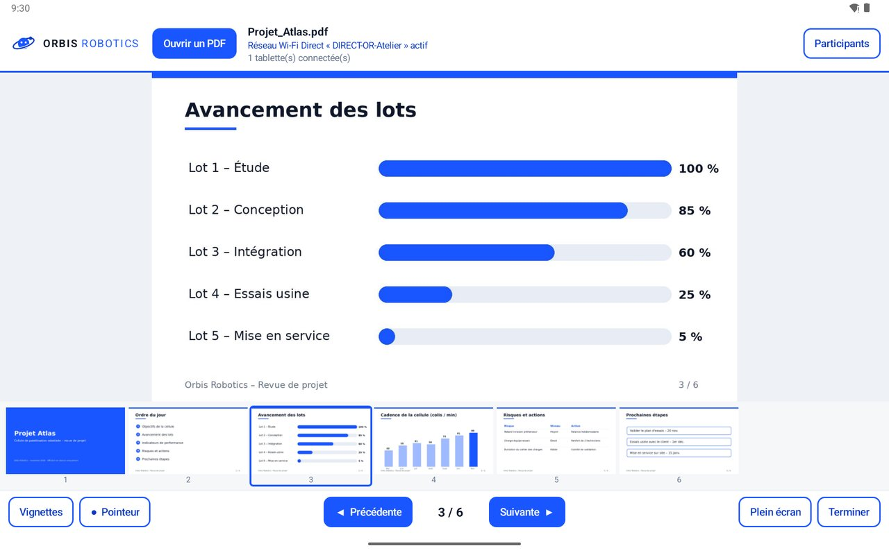
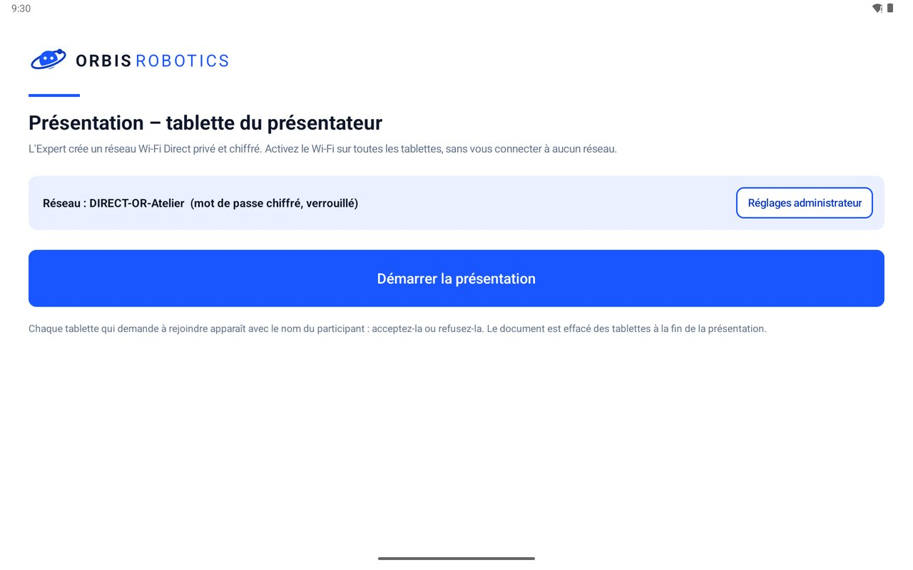
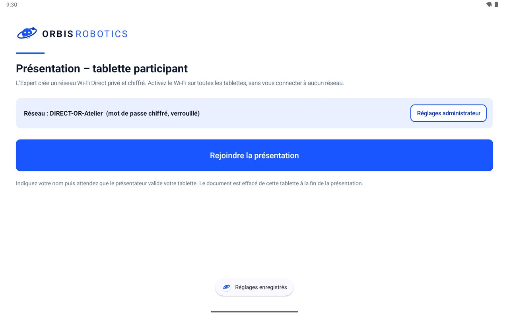
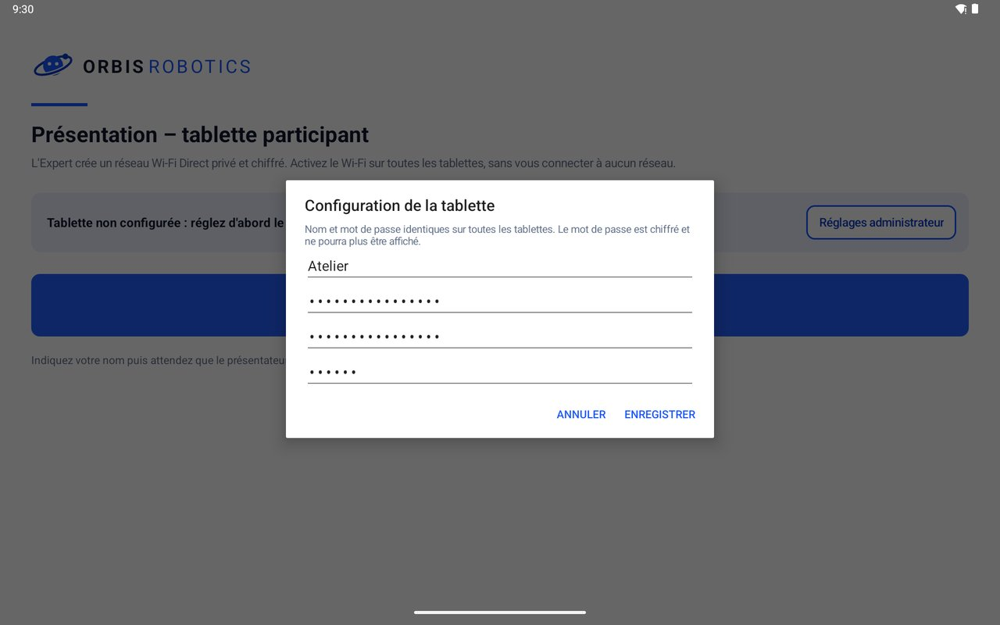
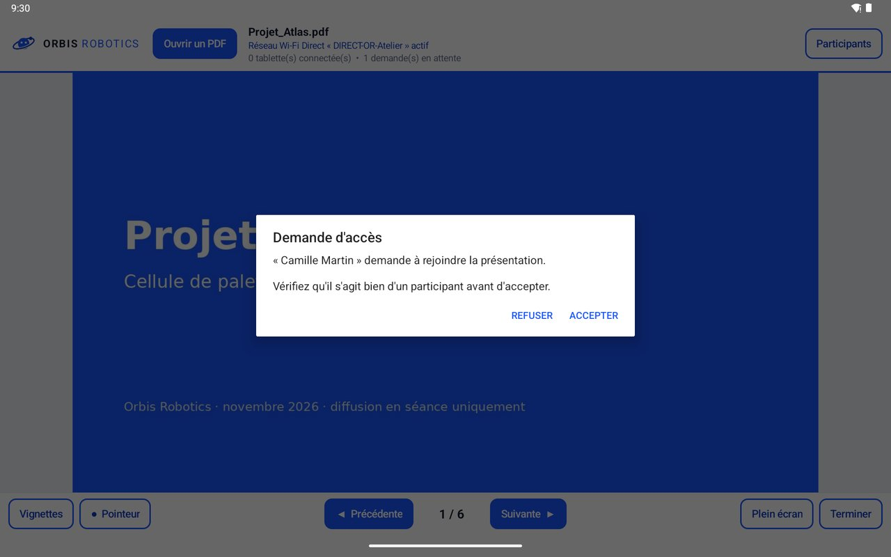
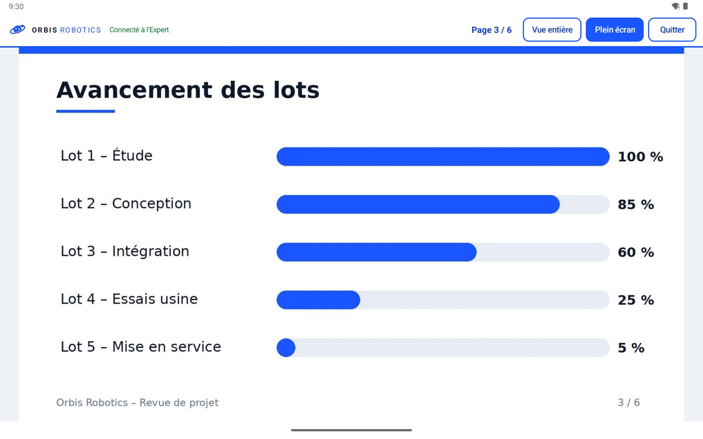
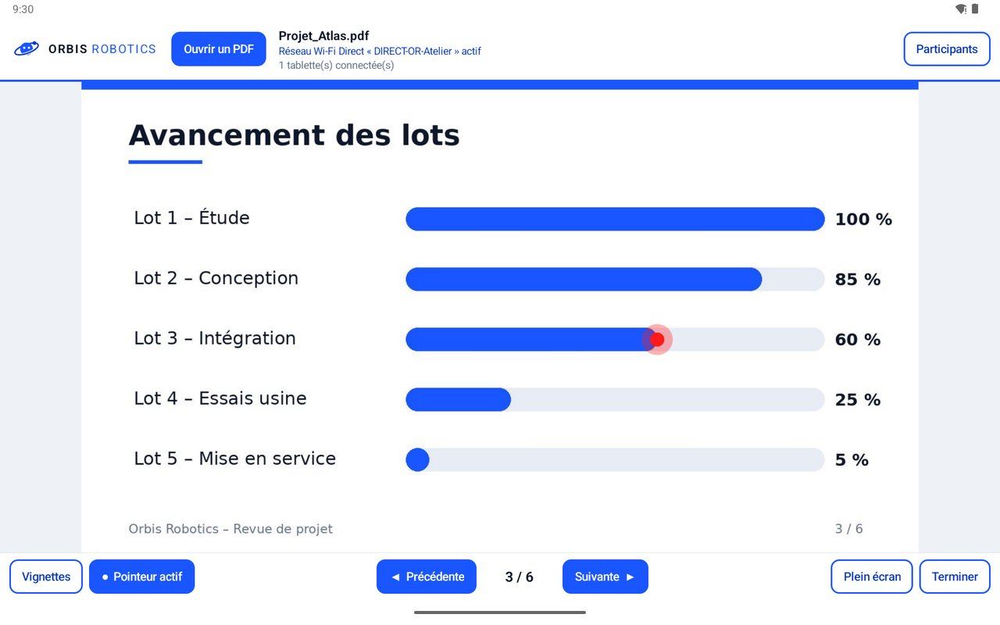
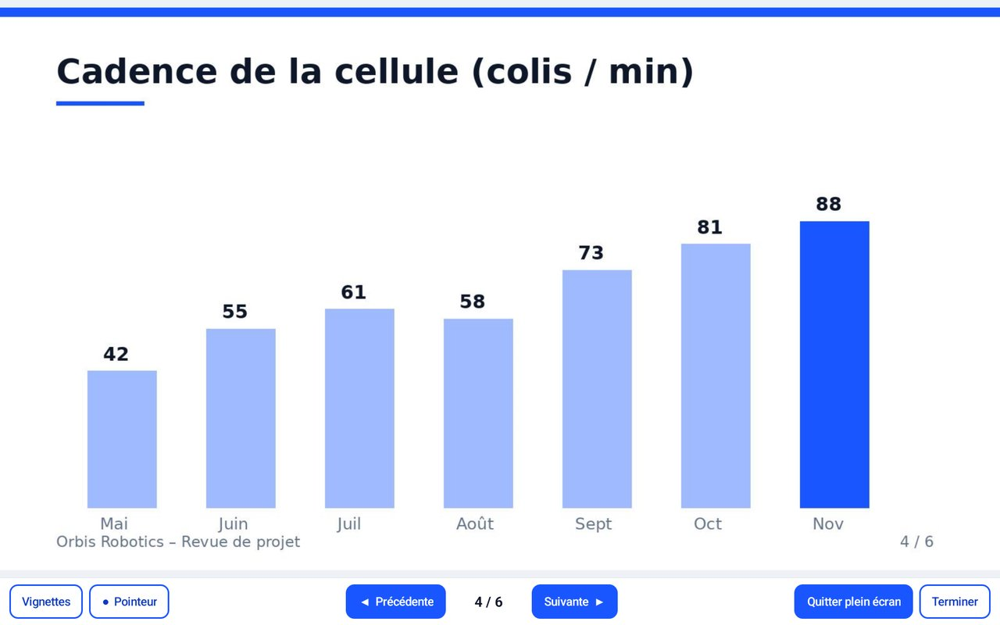
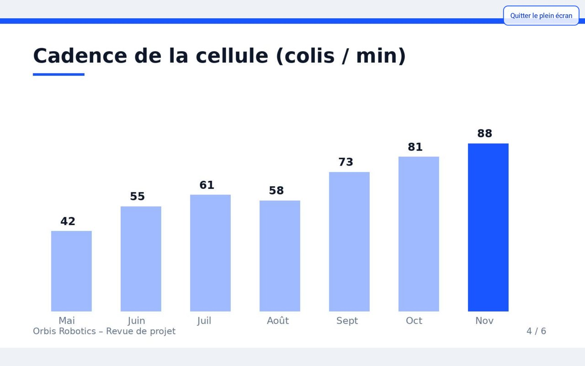

<p align="center"></p>

<p align="center">
  
  
  
  
  
  
</p>

# PDF Sync – présentations synchronisées sur tablettes

Application Android pour **Orbis Robotics**, une entreprise fictive : le logo, le nom et le
document de démonstration sont inventés pour ce projet.

Un présentateur projette un PDF sur sa tablette, et les tablettes des participants affichent la
même page en temps réel. Tout passe par un réseau **Wi-Fi Direct** privé créé par la tablette du
présentateur. Pas de routeur, pas d'internet, pas de cloud.



## Contexte : le cahier des charges

Le besoin de départ :

- diffuser un document confidentiel pendant une réunion, sur 5 à 10 tablettes ;
- **une authentification sécurisée, sans saisir de code à chaque séance** : les participants ne
  doivent ni connaître le mot de passe du réseau, ni taper un code PIN à chaque présentation ;
- aucun document ne doit rester sur les tablettes des participants après la réunion ;
- pas de dépendance à une infrastructure (salle sans Wi-Fi, site client…).

Réponse retenue, l'accès repose sur deux verrous, sans aucun code à retaper :

1. **Le réseau.** Un administrateur configure chaque tablette une seule fois : nom du réseau et
   mot de passe Wi-Fi. Le mot de passe est chiffré (AES-256-GCM) avec une clé de l'Android
   Keystore, non exportable, et n'est plus jamais affiché. Les réglages sont protégés par un code
   administrateur (seule son empreinte PBKDF2 est stockée, blocage progressif après 5 erreurs).
2. **Le présentateur.** Une tablette qui se connecte n'envoie que le nom du participant. Le
   présentateur voit la demande et l'accepte ou la refuse. Rien n'est transmis avant son accord.
   Une tablette déjà acceptée qui perd brièvement le réseau est réadmise automatiquement pendant la
   même séance (identifiant aléatoire propre à l'appareil).

Côté participant, il n'y a donc qu'une étape : indiquer son nom (mémorisé pour les fois suivantes)
et attendre la validation.

## Deux applications

Le projet produit deux APK distincts à partir du même code (product flavors Gradle) :

| Appli | Rôle | Paquet | Android |
|---|---|---|---|
| **Expert** | tablette du présentateur : crée le réseau, ouvre le PDF, pilote la présentation | `com.orbisrobotics.pdfsync.expert` | 10+ |
| **Client** | tablettes des participants : affichent la page courante | `com.orbisrobotics.pdfsync.client` | 7+ (10+ pour la connexion automatique) |

Le code propre à chaque rôle n'est embarqué que dans son APK : un Client ne contient pas le
serveur, l'Expert ne contient pas le client.

## Captures

Tablette 1920 × 1200. Dans l'appli, les écrans de présentation sont protégés contre la capture
(`FLAG_SECURE`) : ces images viennent d'une version de démonstration sur émulateur.

| Accueil Expert | Accueil Client |
|---|---|
|  |  |

| Configuration (une seule fois, par l'administrateur) | Demande d'accès côté présentateur |
|---|---|
|  |  |

| Expert : vignettes et navigation | Client : même page, zoom libre |
|---|---|
|  |  |

| Pointeur sur l'Expert… | …affiché en direct sur les Clients |
|---|---|
|  |  |

| Plein écran Expert (la navigation reste) | Plein écran Client (document seul) |
|---|---|
|  |  |

## Fonctionnalités

- Page synchronisée sur toutes les tablettes : boutons, swipe, touches de volume ou télécommande
  Bluetooth de présentation.
- Zoom indépendant sur chaque Client (pinch, double tap), avec re-rendu net de la zone zoomée.
- Pointeur : le doigt du présentateur affiche un point rouge sur toutes les tablettes.
- Bande de vignettes pour sauter à une page.
- Liste des participants, retrait d'une tablette en cours de séance (son document est effacé).
- Mode plein écran sur les deux applis.
- Effacement du document : à la fin de la séance, quand on quitte, quand l'Expert retire la
  tablette, et après 2 minutes sans liaison. Tout reste éventuel est supprimé au lancement suivant.
- Captures et enregistrement d'écran bloqués.

## Architecture

```
app/src/
├── main/     commun : accueil, réglages chiffrés, Wi-Fi Direct, rendu PDF, vue zoomable, UI
├── expert/   ExpertActivity, SyncServer
└── client/   ClientActivity, SyncClient
```

- **Réseau** : l'Expert crée un groupe Wi-Fi Direct (WPA2) avec un nom et un mot de passe imposés
  (`WifiP2pConfig`, Android 10+), ce qui permet aux Clients de s'y connecter sans popup. Le
  propriétaire du groupe a toujours l'adresse `192.168.49.1` ; le serveur n'écoute que sur cette
  adresse.
- **Protocole** : TCP sur le port 5050, messages binaires simples (`DataInput/OutputStream`), décrits
  dans `Protocol.kt`. Un exécuteur par Client garantit l'ordre des messages et évite qu'une
  tablette lente ne ralentisse les autres. Ping toutes les 3 s, reconnexion automatique.
- **Rendu** : `PdfRenderer` du SDK sur un thread dédié. La page est rendue une fois en base,
  puis la zone visible est re-rendue en haute résolution quand on zoome.
- **Aucune dépendance externe** : uniquement le SDK Android.

## Compiler

Prérequis : JDK 17 et le SDK Android (platform 35, build-tools 35).

```bash
echo "sdk.dir=$HOME/Android/Sdk" > local.properties
./gradlew assembleExpertRelease assembleClientRelease
```

APK produits :

```
app/build/outputs/apk/expert/release/app-expert-release.apk
app/build/outputs/apk/client/release/app-client-release.apk
```

Sans `keystore.properties`, la release est signée avec la clé de debug. Pour signer avec votre
clé, créez `keystore.properties` à la racine (`storeFile`, `storePassword`, `keyAlias`,
`keyPassword`), fichier ignoré par Git.

Installation (débogage USB activé) :

```bash
adb install -r app/build/outputs/apk/expert/release/app-expert-release.apk   # tablette du présentateur
adb install -r app/build/outputs/apk/client/release/app-client-release.apk   # tablettes participants
```

## Utilisation

1. Sur chaque tablette, première fois : *Réglages administrateur* → nom du réseau, mot de passe
   Wi-Fi (12 caractères min., identique partout) et code administrateur.
2. Wi-Fi activé partout, sans se connecter à un réseau (Android 9 à 12 : localisation activée).
3. Expert : *Démarrer la présentation* → *Ouvrir un PDF*.
4. Clients : *Rejoindre la présentation* → nom → attendre la validation.
5. Expert : accepter chaque demande, présenter, puis *Terminer* (document effacé partout).

## Limites connues

- 8 à 10 Clients environ par groupe Wi-Fi Direct, selon la puce Wi-Fi de l'Expert.
- Les Clients sous Android 7 à 9 doivent rejoindre le réseau `DIRECT-OR-…` à la main dans les
  réglages Wi-Fi.
- Le blocage des captures n'empêche évidemment pas de photographier l'écran.
